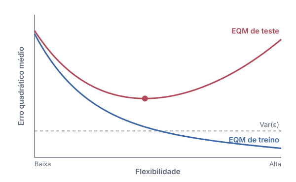

## 1.1 O que é aprendizado estatístico?

Observamos uma resposta $Y$ e $p$ preditores $X = (X_1, \dots, X_p)$, e supomos que

$$
Y = f(X) + \varepsilon
$$

$f$ é fixa, mas desconhecida; $\varepsilon$ é um erro aleatório com média zero, independente de $X$.
**Aprendizado estatístico é um conjunto de abordagens para estimar $f$.**

::: {.content-visible unless-format="revealjs"}
Por exemplo, uma empresa pode registrar as vendas de um produto ($Y$) em 200
mercados, junto com seus orçamentos de publicidade em TV, rádio e jornal
($X_1, X_2, X_3$). Os preditores também são chamados de *entradas*,
*atributos* (*features*) ou *variáveis independentes*; a resposta também é
chamada de *saída* ou *variável dependente*. A função $f$ representa a
informação sistemática que $X$ fornece sobre $Y$; $\varepsilon$ é todo o resto.

A animação abaixo compara essa ideia com o pensamento computacional: em vez de
escrevermos as regras nós mesmos, deixamos um algoritmo estimá-las a partir de
exemplos.

```{=html}
<iframe src="animations/ml-learn-from-data.html"
        title="Pensamento computacional versus aprendizado a partir de dados"
        width="100%" height="590" loading="lazy" allowfullscreen></iframe>
```
:::

::: {.notes}
Pergunte à turma por uma tarefa em que seria impossível escrever as regras à mão.
:::

### 1.1.1 Por que estimar *f*?

:::: {.columns}

::: {.column width="50%"}
**Predição**: só precisamos de boas saídas

$$
\hat Y = \hat f(X)
$$

$\hat f$ pode ser uma caixa-preta. Sua acurácia depende de dois erros:

$$
\mathbb E (Y - \hat Y)^2
= \underbrace{[f(X) - \hat f(X)]^2}_{\text{redutível}}
+ \underbrace{\operatorname{Var}(\varepsilon)}_{\text{irredutível}}
$$
:::

::: {.column width="50%"}
**Inferência**: queremos entender $f$

- Quais preditores estão associados a $Y$?
- Qual é a relação entre $Y$ e cada preditor: positiva, negativa, de que tamanho?
- Um modelo linear é adequado, ou a relação é mais complicada?

Aqui, $\hat f$ não pode ser uma caixa-preta.
:::

::::

::: {.content-visible unless-format="revealjs"}
O erro redutível pode ser diminuído com a escolha de um método de aprendizado
melhor. O irredutível, não: mesmo uma estimativa perfeita, $\hat f = f$, ainda
erra, porque $\varepsilon$ contém variáveis não medidas e aleatoriedade
genuína. Sua variância é um limite para a acurácia de qualquer predição e, na
prática, quase sempre é desconhecida.

Muitos problemas reais combinam os dois objetivos: uma equipe de marketing
quer prever as vendas *e* saber qual mídia as aumenta mais.
:::

### 1.1.2 Como estimamos *f*?

Dadas $n$ observações de treino $\{(x_i, y_i)\}_{i=1}^{n}$, encontrar $\hat f$ tal que $Y \approx \hat f(X)$.

:::: {.columns}

::: {.column width="50%"}
::: {.callout-note appearance="simple"}
## Métodos paramétricos
1. Supor uma forma, por exemplo linear:
   $f(X) = \beta_0 + \beta_1 X_1 + \dots + \beta_p X_p$
2. Ajustá-la: estimar $\beta_0, \dots, \beta_p$, por exemplo por mínimos quadrados.

**+** poucos parâmetros para estimar<br>
**−** se a forma suposta estiver errada, o ajuste é ruim
:::
:::

::: {.column width="50%"}
::: {.callout-tip appearance="simple"}
## Métodos não paramétricos
Nenhuma forma suposta: ajustar $f$ o mais próximo possível dos dados, mantendo-a suave
(por exemplo, *thin-plate splines*, $K$ vizinhos mais próximos).

**+** podem ajustar uma variedade muito maior de formas<br>
**−** precisam de muito mais observações e podem sofrer **sobreajuste**
:::
:::

::::

::: {.content-visible unless-format="revealjs"}
Os métodos paramétricos reduzem o problema de estimar $f$ ao de estimar um
conjunto fixo de parâmetros. Uma forma paramétrica mais flexível consegue
ajustar mais formatos, mas exige mais parâmetros e pode seguir de perto demais
o ruído dos dados de treino. Isso se chama *sobreajuste* (*overfitting*). Os
métodos não paramétricos evitam supor uma forma, mas, como não reduzem o
problema a poucos parâmetros, precisam de muito mais dados para estimar $f$
com acurácia.
:::

### 1.1.3 O trade-off entre acurácia preditiva e interpretabilidade do modelo

:::: {.columns}

::: {.column width="58%"}
{fig-alt="Métodos posicionados por flexibilidade e interpretabilidade: seleção de subconjuntos e lasso são os mais interpretáveis e menos flexíveis; aprendizado profundo, o contrário."}
:::

::: {.column width="42%"}
- Modelos restritivos (regressão linear, lasso) são fáceis de **interpretar**.
- Modelos flexíveis (boosting, SVMs, aprendizado profundo) ajustam $f$ complexas, mas são difíceis de explicar.
- A **inferência** favorece modelos simples.
- Na **predição**, o modelo mais flexível nem sempre é o melhor: ele pode sofrer sobreajuste.
:::

::::

::: {.content-visible unless-format="revealjs"}
Por que escolher um método restritivo? Quando o objetivo é inferência, um
modelo linear deixa claro como cada preditor se relaciona com $Y$, enquanto um
método muito flexível pode gerar uma estimativa tão complicada que o efeito de
cada preditor deixa de ser visível. Contra a intuição, mesmo quando só a
predição importa, um método menos flexível muitas vezes se sai melhor em dados
novos, porque o método flexível está mais sujeito ao sobreajuste.
:::

### 1.1.4 Aprendizado supervisionado versus não supervisionado

{fig-alt="À esquerda, pontos coloridos pela classe conhecida. À direita, os mesmos pontos em cinza, com contornos tracejados em torno de três grupos descobertos." width="72%" fig-align="center" .nostretch}

:::: {.columns}

::: {.column width="50%"}
**Supervisionado**: cada $x_i$ vem com uma resposta $y_i$. Ajustamos um modelo que as relaciona, para predição ou inferência.
:::

::: {.column width="50%"}
**Não supervisionado**: só $x_i$, sem resposta. Buscamos estrutura, por exemplo com **agrupamento** (*clustering*).
:::

::::

::: {.content-visible unless-format="revealjs"}
Regressão linear, regressão logística, modelos aditivos generalizados,
boosting e máquinas de vetores de suporte são todos métodos supervisionados.
No cenário não supervisionado, trabalhamos de certa forma às cegas: não há uma
resposta para supervisionar a análise. A análise de agrupamentos pergunta se
as observações formam grupos distintos, como segmentos de clientes de um
mercado.

Alguns problemas ficam no meio do caminho. Quando apenas $m < n$ observações
têm resposta (porque medi-la é caro), temos um problema *semissupervisionado*.
:::

### 1.1.5 Problemas de regressão versus classificação

| A resposta é… | Exemplos | Problema |
|---|---|---|
| **Quantitativa**: numérica | idade, renda, preço de imóvel, preço de ação | **Regressão** |
| **Qualitativa**: uma de $K$ classes | marca, doença sim/não, tipo de câncer | **Classificação** |

- A distinção depende da **resposta**; os preditores podem ser de qualquer tipo.
- Alguns métodos servem para os dois casos, como $K$ vizinhos mais próximos e boosting.
- A regressão logística é um classificador, mas estima **probabilidades** de classe, então também se comporta como um método de regressão.

## 1.2 Avaliando a acurácia do modelo

**Não existe almoço grátis em estatística**: nenhum método é o melhor em todos os conjuntos de dados.

Por isso, para cada conjunto de dados precisamos decidir qual método dá os
melhores resultados, e isso exige uma forma de **medir** a qualidade de um ajuste.

### 1.2.1 Medindo a qualidade do ajuste

:::: {.columns}

::: {.column width="48%"}
Erro quadrático médio (EQM) nos dados de treino:

$$
\text{EQM} = \frac{1}{n} \sum_{i=1}^{n} \big(y_i - \hat f(x_i)\big)^2
$$

O que realmente importa é o **EQM de teste**, em dados não vistos:

$$
\text{Média}\big(y_0 - \hat f(x_0)\big)^2
$$

Um EQM de treino pequeno não garante um EQM de teste pequeno.
:::

::: {.column width="52%"}
{fig-alt="À medida que a flexibilidade cresce, o EQM de treino continua caindo, até abaixo de Var(épsilon), enquanto o EQM de teste cai e depois sobe, em formato de U."}
:::

::::

::: {.content-visible unless-format="revealjs"}
À medida que a flexibilidade aumenta, o EQM de treino continua diminuindo, mas
o EQM de teste primeiro cai e depois sobe. Quando um método tem EQM de treino
pequeno e EQM de teste grande, ele está sofrendo *sobreajuste*: captou padrões
causados pelo acaso, e não pela verdadeira $f$. O EQM de teste nunca fica
abaixo de $\operatorname{Var}(\varepsilon)$, a linha tracejada. Quando não há
um conjunto de teste disponível, a validação cruzada (um capítulo posterior)
estima o EQM de teste a partir dos dados de treino.
:::

### 1.2.2 O trade-off entre viés e variância

```{=html}
<iframe src="animations/bias-variance.html"
        title="O trade-off entre viés e variância"
        width="100%" height="590" loading="lazy" allowfullscreen></iframe>
```

::: {.content-visible unless-format="revealjs"}
O EQM de teste esperado em um ponto $x_0$ se decompõe em três termos não
negativos:

$$
\mathbb E\big(y_0 - \hat f(x_0)\big)^2
= \operatorname{Var}\big(\hat f(x_0)\big)
+ \big[\text{Viés}\big(\hat f(x_0)\big)\big]^2
+ \operatorname{Var}(\varepsilon).
$$

A *variância* mede quanto $\hat f$ mudaria se a estimássemos com outro
conjunto de treino. O *viés* é o erro introduzido ao aproximar um problema
real, que pode ser muito complicado, por um modelo bem mais simples. Em geral,
métodos mais flexíveis têm variância maior e viés menor. Qual efeito domina
determina se o EQM de teste sobe ou desce, e o objetivo é encontrar o nível de
flexibilidade em que a soma dos dois é mínima.
:::

### 1.2.3 O cenário de classificação

:::: {.columns}

::: {.column width="56%" .smaller-text}
**Taxa de erro** de treino: $\displaystyle \frac{1}{n} \sum_{i=1}^{n} I(y_i \neq \hat y_i)$

**Classificador de Bayes**: atribui $x_0$ à classe $j$ com o maior
$\Pr(Y = j \mid X = x_0)$. Tem o menor erro de teste possível (a taxa de erro de Bayes).

**$K$ vizinhos mais próximos** (KNN) estima essa probabilidade a partir dos $K$ pontos de treino mais próximos, $\mathcal N_0$:

$$
\Pr(Y = j \mid X = x_0) \approx \frac{1}{K} \sum_{i \in \mathcal N_0} I(y_i = j)
$$

$K$ pequeno: flexível, viés baixo, variância alta. $K$ grande: fronteira mais suave.
:::

::: {.column width="44%"}
{fig-alt="Duas classes de pontos, com a fronteira de decisão de Bayes tracejada separando as regiões sombreadas."}
:::

::::

::: {.content-visible unless-format="revealjs"}
Na classificação, o indicador $I(y_i \neq \hat y_i)$ vale 1 para um erro e 0
caso contrário, então a taxa de erro é a fração de classificações erradas.
Assim como no EQM, o que importa é a taxa de erro de *teste*,
$\text{Média}\big(I(y_0 \neq \hat y_0)\big)$.

O classificador de Bayes é um ideal: em dados reais não conhecemos a
distribuição condicional de $Y$ dado $X$, então ele não pode ser calculado.
Sua taxa de erro, $1 - \mathbb E\big(\max_j \Pr(Y = j \mid X)\big)$, faz o
papel do erro irredutível. Métodos como o KNN tentam aproximá-lo. Com $K = 1$,
a fronteira de decisão é muito flexível e o erro de treino é zero, mas o erro
de teste pode ser alto; à medida que $K$ cresce, a fronteira fica quase linear.
O trade-off entre viés e variância aparece de novo.
:::
