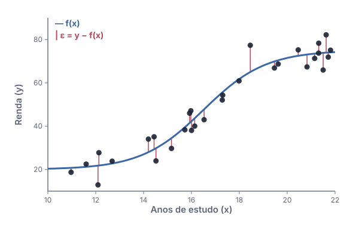
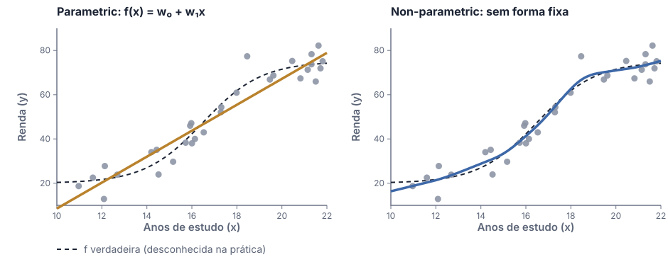
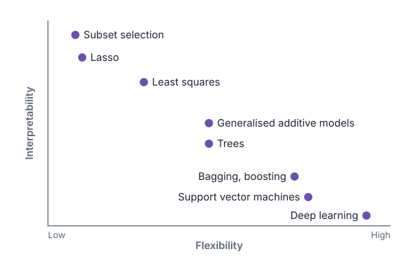
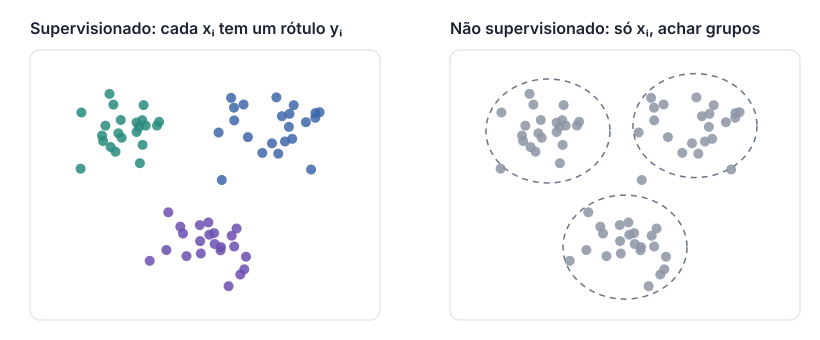
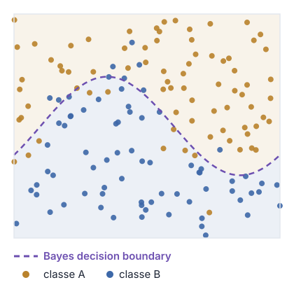
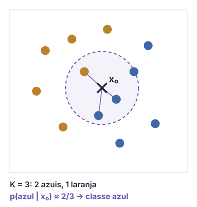
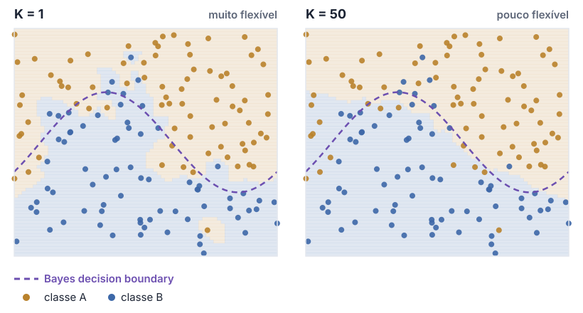
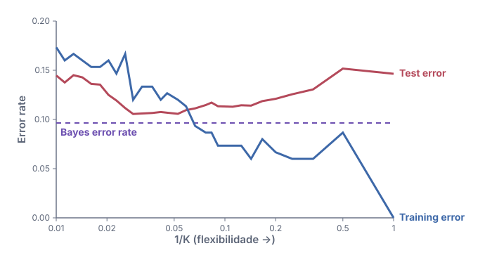
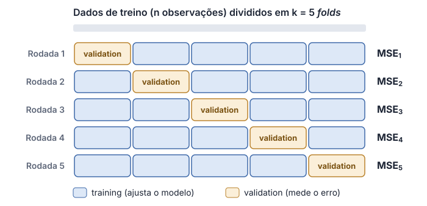

## 1.1 *Machine learning* em contexto

Antes das equações: de onde vem o *machine learning*, onde ele se encaixa e o
que significa dizer que um programa **aprende**.

### 1.1.1 *Classical* versus *intelligent computational thinking*

```{=html}
<iframe src="animations/ml-learn-from-data.html"
        title="Classical CT versus intelligent CT"
        width="100%" height="600" loading="lazy" allowfullscreen></iframe>
```

::: {.content-visible unless-format="revealjs"}
No *classical computational thinking*, resolvemos um problema decompondo-o,
reconhecendo padrões, abstraindo e escrevendo um algoritmo: uma pessoa escreve
as regras, e o computador as executa. No *intelligent computational thinking*,
fornecemos exemplos de entradas junto com as saídas desejadas, e um algoritmo
de aprendizado estima as regras, codificadas nos pesos $\mathbf w$ de um
modelo. Depois de treinado, o modelo é usado como um programa comum.
:::

::: {.notes}
Pergunte à turma por uma tarefa em que seria impossível escrever as regras à mão.
:::

### 1.1.2 Onde o *machine learning* se encaixa

```{=html}
<iframe src="animations/ml-in-context.html"
        title="Machine learning em contexto"
        width="100%" height="600" loading="lazy" allowfullscreen></iframe>
```

::: {.content-visible unless-format="revealjs"}
O *machine learning* é um subconjunto da *artificial intelligence* e vive no
encontro entre ciência da computação, estatística e o domínio de aplicação.
A segunda aba mostra o mesmo raciocínio do ponto de vista das competências
profissionais: quem combina programação, matemática/estatística e conhecimento
do domínio está no centro, como cientista de dados ou de ML.
:::

### 1.1.3 O que é aprender? *Task*, *performance* e *experience*

> "A computer program is said to learn from **experience** $E$ with respect to some class of **tasks** $T$ and **performance measure** $P$, if its performance at tasks in $T$, as measured by $P$, improves with experience $E$."
> — Mitchell (1997)

:::: {.columns .smaller-text}

::: {.column width="33%"}
**$T$ — *task***<br>
O que o sistema deve fazer.<br>
Ex.: decidir se um e-mail é spam (*classification*).
:::

::: {.column width="33%"}
**$P$ — *performance measure***<br>
Como medimos o quão bem ele faz.<br>
Ex.: *accuracy*, a fração de e-mails classificados corretamente.
:::

::: {.column width="33%"}
**$E$ — *experience***<br>
Os dados com que ele aprende.<br>
Ex.: e-mails já rotulados como spam ou não spam.
:::

::::

::: aside
Goodfellow, Bengio & Courville, *Deep Learning* (2016), §5.1.
:::

::: {.content-visible unless-format="revealjs"}
Em português: diz-se que um programa de computador aprende com a experiência
$E$, em relação a uma classe de tarefas $T$ e a uma medida de desempenho $P$,
se o seu desempenho nas tarefas de $T$, medido por $P$, melhora com a
experiência $E$. O tipo de experiência define grandes famílias de algoritmos:
em *supervised learning* cada exemplo traz a resposta desejada; em
*unsupervised learning*, não (veja a Seção 1.2.5).
:::

## 1.2 O que é *statistical learning*?

Observamos uma resposta $y$ e $p$ entradas (*features*) $\mathbf x = (x_1, \dots, x_p)$, e supomos que

$$
y = f(\mathbf x) + \varepsilon
$$

$f$ é fixa, mas desconhecida; $\varepsilon$ é um erro aleatório com média zero, independente de $\mathbf x$.
**_Statistical learning_ é um conjunto de abordagens para estimar $f$.**

### 1.2.1 Um exemplo: renda e anos de estudo

:::: {.columns}

::: {.column width="60%"}
{fig-alt="Renda versus anos de estudo para 30 pessoas, com a curva f em azul e os erros epsilon como segmentos vermelhos."}
:::

::: {.column width="40%"}
- 30 pessoas: anos de estudo ($x$) e renda ($y$).
- A curva azul é $f$: a parte **sistemática** da relação.
- Os segmentos vermelhos são os erros $\varepsilon$: média zero, ora acima, ora abaixo.
- Na prática, $f$ é **desconhecida**: precisamos estimá-la a partir dos dados.
:::

::::

::: aside
Dados simulados, inspirados no conjunto *Income* do ISLP, cap. 2.
:::

### 1.2.2 Por que estimar *f*?

:::: {.columns}

::: {.column width="50%"}
***Prediction***: só precisamos de boas saídas

$$
\hat y = \hat f(\mathbf x)
$$

$\hat f$ pode ser uma *black box*. Sua acurácia depende de dois erros:

$$
\mathbb E (y - \hat y)^2
= \underbrace{[f(\mathbf x) - \hat f(\mathbf x)]^2}_{\textit{reducible error}}
+ \underbrace{\operatorname{Var}(\varepsilon)}_{\textit{irreducible error}}
$$
:::

::: {.column width="50%"}
***Inference***: queremos **entender** $f$

- Como $y$ muda quando cada entrada $x_j$ muda?
- Aqui, $\hat f$ **não** pode ser uma *black box*.
- O próximo slide traz as três perguntas típicas de *inference*.
:::

::::

::: {.content-visible unless-format="revealjs"}
O *reducible error* pode ser diminuído com a escolha de um método de
aprendizado melhor. O *irreducible error*, não: mesmo uma estimativa perfeita,
$\hat f = f$, ainda erra, porque $\varepsilon$ contém variáveis não medidas e
aleatoriedade genuína. $\operatorname{Var}(\varepsilon)$ é um limite para a
acurácia de qualquer predição e, na prática, quase sempre é desconhecida.
:::

### *Inference*: três perguntas {.unlisted}

::: {.smaller-text}
1. **Quais entradas estão associadas à resposta?** Muitas vezes, só uma pequena fração das entradas disponíveis está fortemente associada a $y$. Identificar as poucas entradas *importantes* entre muitas variáveis possíveis pode ser extremamente útil, dependendo da aplicação.

2. **Qual é a relação entre a resposta e cada entrada?** Algumas entradas têm relação positiva com $y$: valores maiores da entrada estão associados a valores maiores de $y$. Outras têm a relação oposta. Dependendo da complexidade de $f$, a relação entre a resposta e uma entrada também pode depender dos valores das outras entradas.

3. **A relação entre $y$ e cada entrada pode ser resumida por uma equação linear, ou é mais complicada?** Historicamente, a maioria dos métodos para estimar $f$ é linear. Às vezes essa hipótese é razoável ou até desejável; muitas vezes, porém, a relação verdadeira é mais complicada, e um modelo linear não a representa bem.
:::

::: aside
James, Witten, Hastie, Tibshirani & Taylor, *An Introduction to Statistical Learning with Applications in Python* (ISLP), §2.1.1.
:::

### 1.2.3 Como estimamos *f*?

Com o *training data* $\{(\mathbf x_i, y_i)\}_{i=1}^{n}$, encontrar $\hat f$ com $y \approx \hat f(\mathbf x)$.

{fig-alt="Renda versus anos de estudo: à esquerda, uma reta ajustada (parametric); à direita, uma curva suave que segue a forma dos dados (non-parametric)." width="66%" fig-align="center" .nostretch}

:::: {.columns .smaller-text}

::: {.column width="50%"}
***Parametric***: supor uma forma, p. ex. $f(\mathbf x) = w_0 + w_1 x_1 + \dots + w_p x_p$, e estimar os pesos $\mathbf w$ (*least squares*). Erra se a forma estiver errada.
:::

::: {.column width="50%"}
***Non-parametric***: nenhuma forma fixa (p. ex. *smoothing splines*). Mais flexível, mas precisa de mais dados e corre risco de ***overfitting***.
:::

::::

::: {.content-visible unless-format="revealjs"}
Os métodos *parametric* reduzem o problema de estimar $f$ ao de estimar um
conjunto fixo de pesos $\mathbf w$. Na figura, a reta $\hat f(x) = \hat w_0 +
\hat w_1 x$ não consegue acompanhar a forma em "S" da relação verdadeira. Os
métodos *non-parametric* evitam supor uma forma: o *smoothing spline* da
direita acompanha $f$ de perto. Como não reduzem o problema a poucos
parâmetros, porém, eles precisam de muito mais dados, e uma versão flexível
demais pode seguir o ruído dos dados de treino, o que chamamos de
*overfitting* (Seção 1.3.2).
:::

### Os três componentes do *machine learning* {.unlisted}

::: {.smaller-text}
- *Training data*: $\{(\mathbf x_i, y_i)\}_{i=1}^{n}$, com $\mathbf x_i \in \mathcal X$ e $y_i \in \mathcal Y$
- Modelo: $f(\,\cdot\,; \mathbf w) : \mathcal X \to \mathcal Y$, com pesos $\mathbf w$
- *Loss function*: $L : \mathcal Y \times \mathcal Y \to \mathbb R$
  - *Regression*: $\mathcal Y = \mathbb R$ e $L(y, \hat y) = (y - \hat y)^2$
  - *Classification*: $\mathcal Y = \{0, 1\}$ e $L(y, \hat y) = \mathbb I[y \neq \hat y]$
- Objetivo: minimizar o *risk* $\;\mathbb E\big[L\big(y, f(\mathbf x; \mathbf w)\big)\big]$, com $f$ numa classe $\mathcal F$ que precisa ser escolhida
- Na prática, minimizamos o *empirical risk* (trocamos o valor esperado pela média):

$$
\hat{\mathbf w} = {\color{#1f4fa0}{\arg\min_{\mathbf w}}} \; {\color{#c62828}{\frac{1}{n} \sum_{i=1}^{n} L\big(y_i, f(\mathbf x_i; \mathbf w)\big)}}, \qquad f(\,\cdot\,; \mathbf w) \in {\color{#2e7d32}{\mathcal F}}
$$

Três componentes básicos: (i) [*model class* $\mathcal F$]{style="color:#2e7d32"}; (ii) [*loss function* $L$]{style="color:#c62828"}; (iii) [*optimizer*]{style="color:#1f4fa0"}.

*Test error*: com um *test set* $\text{Te}$ de $n_{\text{te}}$ pontos novos, $\;\frac{1}{n_{\text{te}}} \sum_{i \in \text{Te}} L\big(y_i, f(\mathbf x_i; \hat{\mathbf w})\big)$.
:::

::: aside
Adaptado de: Prof. Paulo Orenstein (IMPA).
:::

### 1.2.4 *Prediction accuracy* versus *model interpretability*

:::: {.columns}

::: {.column width="58%"}
{fig-alt="Métodos posicionados por flexibilidade e interpretabilidade: subset selection e lasso são os mais interpretáveis e menos flexíveis; deep learning, o contrário."}
:::

::: {.column width="42%"}
- Modelos restritivos (*linear regression*, *lasso*) são fáceis de **interpretar**.
- Modelos flexíveis (*boosting*, *SVMs*, *deep learning*) ajustam $f$ complexas, mas são difíceis de explicar.
- *Inference* favorece modelos simples.
- Em *prediction*, o modelo mais flexível nem sempre é o melhor: ele pode sofrer *overfitting*.
:::

::::

::: {.content-visible unless-format="revealjs"}
Por que escolher um método restritivo? Quando o objetivo é *inference*, um
modelo linear deixa claro como cada entrada se relaciona com $y$, enquanto um
método muito flexível pode gerar uma estimativa tão complicada que o efeito de
cada entrada deixa de ser visível. Contra a intuição, mesmo quando só a
*prediction* importa, um método menos flexível muitas vezes se sai melhor em
dados novos, porque o flexível está mais sujeito ao *overfitting*.
:::

### 1.2.5 *Supervised* versus *unsupervised learning*

{fig-alt="À esquerda, pontos coloridos pela classe conhecida. À direita, os mesmos pontos em cinza, com contornos tracejados em torno de três grupos descobertos." width="72%" fig-align="center" .nostretch}

:::: {.columns}

::: {.column width="50%"}
***Supervised learning***: cada $\mathbf x_i$ vem com uma resposta $y_i$. Ajustamos um modelo que as relaciona, para *prediction* ou *inference*.
:::

::: {.column width="50%"}
***Unsupervised learning***: só $\mathbf x_i$, sem resposta. Buscamos estrutura, por exemplo com ***clustering***.
:::

::::

::: {.content-visible unless-format="revealjs"}
*Linear regression*, *logistic regression*, *generalized additive models*,
*boosting* e *support vector machines* são métodos de *supervised learning*.
No cenário *unsupervised*, trabalhamos de certa forma às cegas: não há uma
resposta para supervisionar a análise. O *clustering* pergunta se as
observações formam grupos distintos, como segmentos de clientes de um mercado.
Quando apenas $m < n$ observações têm resposta (porque medi-la é caro), temos
um problema de *semi-supervised learning*.
:::

### 1.2.6 *Regression* versus *classification*

| A resposta $y$ é… | Exemplos | Problema |
|---|---|---|
| ***Quantitative***: numérica | idade, renda, preço de imóvel, preço de ação | ***Regression*** |
| ***Qualitative***: uma de $K$ classes | marca, doença sim/não, tipo de câncer | ***Classification*** |

- A distinção depende da **resposta**; as entradas podem ser de qualquer tipo.
- Alguns métodos servem para os dois casos, como *K-nearest neighbors* e *boosting*.
- A *logistic regression* é um classificador, mas estima **probabilidades** de classe, então também se comporta como um método de *regression*.

## 1.3 Avaliando a acurácia do modelo

Para cada conjunto de dados, precisamos escolher um método. Isso exige uma
forma de **medir** a qualidade de um ajuste, e saber que nenhum método vence sempre.

### 1.3.1 *No Free Lunch theorem*

> Em média, sobre **todas** as distribuições possíveis que geram os dados, todo algoritmo de *classification* tem a mesma *error rate* ao classificar pontos ainda não observados.

- Nenhum algoritmo de *machine learning* é universalmente melhor que outro.
- O objetivo não é buscar "o melhor algoritmo", mas entender **que tipos de distribuição** aparecem no mundo real e quais algoritmos funcionam bem nelas.
- Na prática: para **cada** conjunto de dados, comparamos métodos. Por isso precisamos medir a qualidade do ajuste.

::: aside
Wolpert (1996); Goodfellow et al., *Deep Learning*, §5.2.1; ISLP, §2.2.
:::

### 1.3.2 Medindo a qualidade do ajuste

:::: {.columns}

::: {.column width="50%"}
*Mean squared error* nos dados de treino (***training MSE***):

$$
\text{MSE} = \frac{1}{n} \sum_{i=1}^{n} \big(y_i - \hat f(\mathbf x_i)\big)^2
$$
:::

::: {.column width="50%"}
O que realmente importa é o ***test MSE***, em dados não vistos $(\mathbf x_0, y_0)$:

$$
\operatorname{Ave}\big(y_0 - \hat f(\mathbf x_0)\big)^2
$$
:::

::::

- Queremos o método com o menor ***test MSE***, não o menor *training MSE*.
- Um *training MSE* pequeno **não** garante um *test MSE* pequeno: o próximo slide mostra por quê.

::: {.content-visible unless-format="revealjs"}
O *training MSE* é calculado com os mesmos dados usados para ajustar o modelo,
então ele é otimista. O *test MSE* mede o desempenho em observações que o
método nunca viu, que é o que interessa ao usar o modelo. Quando não há um
*test set* disponível, a *cross-validation* (Seção 1.3.5) estima o *test MSE*
a partir dos próprios dados de treino.
:::

### *Overfitting* na prática {.unlisted}

```{=html}
<iframe src="animations/overfitting.html"
        title="Overfitting na prática"
        width="100%" height="590" loading="lazy" allowfullscreen></iframe>
```

::: {.content-visible unless-format="revealjs"}
À medida que a flexibilidade aumenta, o *training MSE* continua diminuindo,
mas o *test MSE* primeiro cai e depois sobe, formando um U. Quando um método
tem *training MSE* pequeno e *test MSE* grande, ele está sofrendo
*overfitting*: captou padrões causados pelo acaso, e não pela verdadeira $f$.
O *test MSE* nunca fica abaixo de $\operatorname{Var}(\varepsilon)$, a linha
tracejada. A animação usa os mesmos dados de renda da Seção 1.2.1, ajustados
por uma reta e por *smoothing splines* de flexibilidade crescente.
:::

### 1.3.3 *Bias-variance trade-off*

```{=html}
<iframe src="animations/bias-variance.html"
        title="Bias-variance trade-off"
        width="100%" height="590" loading="lazy" allowfullscreen></iframe>
```

::: {.content-visible unless-format="revealjs"}
O *test MSE* esperado em um ponto $\mathbf x_0$ se decompõe em três termos não
negativos:

$$
\mathbb E\big(y_0 - \hat f(\mathbf x_0)\big)^2
= \operatorname{Var}\big(\hat f(\mathbf x_0)\big)
+ \big[\operatorname{Bias}\big(\hat f(\mathbf x_0)\big)\big]^2
+ \operatorname{Var}(\varepsilon).
$$

A *variance* mede quanto $\hat f$ mudaria se a estimássemos com outro
*training set*. O *bias* é o erro introduzido ao aproximar um problema real,
que pode ser muito complicado, por um modelo bem mais simples. Em geral,
métodos mais flexíveis têm *variance* maior e *bias* menor. Qual efeito domina
determina se o *test MSE* sobe ou desce, e o objetivo é encontrar a
flexibilidade em que a soma dos dois é mínima.
:::

### 1.3.4 O cenário de *classification*

Agora $y$ é qualitativa, e $\hat y_i$ é a classe prevista para $\mathbf x_i$.

:::: {.columns}

::: {.column width="50%"}
***Training error rate***:

$$
\frac{1}{n} \sum_{i=1}^{n} I(y_i \neq \hat y_i)
$$
:::

::: {.column width="50%"}
***Test error rate***:

$$
\operatorname{Ave}\big(I(y_0 \neq \hat y_0)\big)
$$
:::

::::

- $I(y_i \neq \hat y_i)$ é um *indicator*: vale 1 se erramos e 0 se acertamos.
- A *error rate* é a fração de classificações erradas.
- Como no MSE, o bom classificador é o de menor ***test*** *error rate*.

### O *Bayes classifier* {.unlisted}

:::: {.columns}

::: {.column width="55%" .smaller-text}
Atribua cada $\mathbf x_0$ à classe $j$ com a maior probabilidade condicional:

$$
\hat y_0 = \arg\max_j \; \Pr(y = j \mid \mathbf x = \mathbf x_0)
$$

::: {.callout-important appearance="simple"}
**Conclusão:** escolha simplesmente a classe **mais provável**.
:::

- Com duas classes: classe A se $\Pr(y = A \mid \mathbf x_0) > 0{,}5$.
- A ***Bayes decision boundary*** é onde a probabilidade é exatamente 0,5.
- Tem a menor *test error rate* possível: a ***Bayes error rate***, $1 - \mathbb E\big[\max_j \Pr(y = j \mid \mathbf x)\big]$, análoga ao *irreducible error*.
:::

::: {.column width="45%"}
{fig-alt="Duas classes de pontos, com a Bayes decision boundary tracejada separando as regiões sombreadas."}
:::

::::

::: {.content-visible unless-format="revealjs"}
O *Bayes classifier* é um ideal: em dados reais não conhecemos a distribuição
condicional de $y$ dado $\mathbf x$, então ele não pode ser calculado. Ele
serve de referência, um "padrão-ouro" que os métodos reais tentam aproximar.
Na figura, cerca de 10% dos pontos caem do lado "errado" da fronteira: essa é,
aproximadamente, a *Bayes error rate* deste exemplo.
:::

### *K-nearest neighbors* (KNN) {.unlisted}

:::: {.columns}

::: {.column width="58%"}
Como não conhecemos $\Pr(y = j \mid \mathbf x)$, o KNN a **estima**:

1. Dado $K$ e um ponto de teste $\mathbf x_0$, encontre os $K$ pontos de treino mais próximos, $\mathcal N_0$.
2. Estime a probabilidade de cada classe pela fração de vizinhos:
   $$
   \Pr(y = j \mid \mathbf x = \mathbf x_0) \approx \frac{1}{K} \sum_{i \in \mathcal N_0} I(y_i = j)
   $$
3. Classifique $\mathbf x_0$ na classe **mais provável**, como o *Bayes classifier*.
:::

::: {.column width="42%"}
{fig-alt="Um ponto de teste x0 e o círculo com seus 3 vizinhos mais próximos: 2 azuis e 1 laranja, então a previsão é azul."}
:::

::::

### Escolhendo *K* {.unlisted}

{fig-alt="Regiões de decisão do KNN com K igual a 1, muito irregulares, e com K igual a 50, suaves, comparadas à Bayes decision boundary." width="66%" fig-align="center" .nostretch}

- $K$ **controla a flexibilidade**: $K = 1$ segue cada ponto (*low bias*, *high variance*); $K = 50$ é quase linear (*high bias*, *low variance*).

### *Training* versus *test error* no KNN {.unlisted}

:::: {.columns}

::: {.column width="62%"}
{fig-alt="Training error rate e test error rate do KNN em função de 1/K: o training error cai até zero; o test error tem forma de U, com mínimo perto da Bayes error rate."}
:::

::: {.column width="38%" .smaller-text}
- Com $1/K$ crescendo, o modelo fica mais flexível.
- O *training error* cai até **zero** ($K = 1$).
- O *test error* tem a mesma forma em **U** da *regression*: o *bias-variance trade-off* de novo.
- O mínimo fica perto da *Bayes error rate*.
- Como escolher $K$ sem um *test set*? Com ***cross-validation***.
:::

::::

### 1.3.5 *Cross-validation*

:::: {.columns}

::: {.column width="55%"}
{fig-alt="k-fold cross-validation com k = 5: em cada rodada, um fold diferente é usado como validation e os outros quatro como training."}
:::

::: {.column width="45%" .smaller-text}
***k-fold cross-validation***:

1. Divida os dados de treino em $k$ partes (*folds*).
2. Para cada fold: ajuste o modelo nos outros $k - 1$ e calcule o erro no fold separado, $\text{MSE}_i$.
3. Faça a média:
   $$
   \text{CV}_{(k)} = \frac{1}{k} \sum_{i=1}^{k} \text{MSE}_i
   $$

Escolha a flexibilidade (p. ex. o $K$ do KNN) com o menor $\text{CV}_{(k)}$. Valores comuns: $k = 5$ ou $10$; com $k = n$, temos *leave-one-out cross-validation* (LOOCV).
:::

::::

::: {.content-visible unless-format="revealjs"}
A *cross-validation* estima o *test error* sem precisar de um *test set*
separado: cada observação é usada para validação exatamente uma vez e para
treino $k - 1$ vezes. Em *classification*, usamos a *error rate* de cada fold
no lugar do $\text{MSE}_i$. A *cross-validation* é a forma padrão de escolher a
flexibilidade de um método, ou seja, de encontrar o fundo do U visto nas
seções anteriores. Ela é estudada em detalhe no ISLP, cap. 5.
:::

## Recursos online

- [**Deep Learning**](https://www.deeplearningbook.org/), Goodfellow, Bengio & Courville (MIT Press, 2016). Livro completo, gratuito online.
- [**An Introduction to Statistical Learning**](https://www.statlearning.com/) (ISLR / ISLP), James, Witten, Hastie, Tibshirani & Taylor. PDFs gratuitos, com versões em R e em Python.
- [**The Hundred-Page Machine Learning Book**](https://themlbook.com/), Andriy Burkov. Uma visão geral concisa de *machine learning*.
- [**Programa de Mestrado: Machine Learning (2026)**](https://www.youtube.com/playlist?list=PLo4jXE-LdDTRLGDL59SkkLPBHVmYphuqI), IMPA. Playlist de aulas no YouTube, em português.
