## 2.1 *Simple linear regression*

Prever uma resposta quantitativa $y$ a partir de **um** preditor $x$, supondo uma relação aproximadamente linear:

$$
y \approx w_0 + w_1 x
$$

$w_0$ é o *intercept* e $w_1$ o *slope*. Com estimativas $\hat w_0, \hat w_1$, a predição é $\hat y = \hat w_0 + \hat w_1 x$.

::: {.content-visible unless-format="revealjs"}
Ao longo do capítulo usamos um conjunto de dados simulado, inspirado no
*Advertising* do ISLP: para 200 mercados, o orçamento de publicidade em TV,
radio e newspaper (em mil US\$) e as vendas de um produto (em mil unidades).
A pergunta de negócio é como planejar a publicidade para aumentar as vendas.
:::

### 2.1.1 Estimando os coeficientes

:::: {.columns}

::: {.column width="52%"}
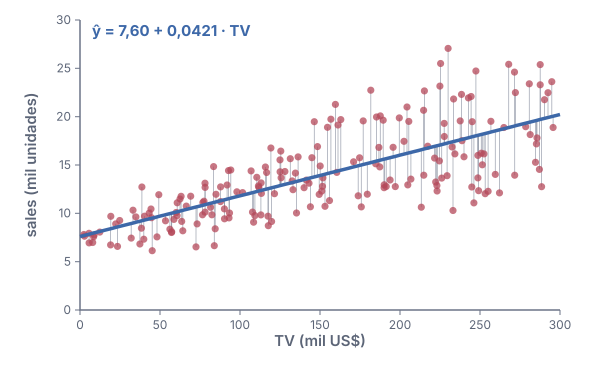{fig-alt="Vendas versus orçamento de TV em 200 mercados, com a reta de least squares e os resíduos como segmentos verticais."}
:::

::: {.column width="48%" .smaller-text}
- *Residual*: $e_i = y_i - \hat y_i$, a distância vertical até a reta.
- *Residual sum of squares*: $\text{RSS} = e_1^2 + \dots + e_n^2$.
- ***Least squares***: escolher $\hat w_0, \hat w_1$ que **minimizam** o RSS:
  $$
  \hat w_1 = \frac{\sum_{i=1}^{n} (x_i - \bar x)(y_i - \bar y)}{\sum_{i=1}^{n} (x_i - \bar x)^2}
  $$
  $$
  \hat w_0 = \bar y - \hat w_1 \bar x
  $$
:::

::::

::: aside
Dados simulados, inspirados no conjunto *Advertising* do ISLP, §3.1.
:::

### *Least squares* passo a passo {.unlisted}

```{=html}
<iframe src="animations/least-squares.html"
        title="Least squares passo a passo"
        width="100%" height="590" loading="lazy" allowfullscreen></iframe>
```

::: {.content-visible unless-format="revealjs"}
Cada reta candidata tem o seu RSS. Fixando a reta para passar pelo ponto médio
$(\bar x, \bar y)$, o RSS em função da inclinação $w_1$ é uma parábola, e a
reta de *least squares* corresponde ao seu mínimo. Derivando o RSS em relação
a $w_0$ e $w_1$ e igualando a zero, chegamos às fórmulas do slide anterior.
:::

### 2.1.2 Avaliando a acurácia das estimativas dos coeficientes

```{=html}
<iframe src="animations/sampling.html"
        title="Population regression line e least squares lines"
        width="100%" height="600" loading="lazy" allowfullscreen></iframe>
```

::: {.content-visible unless-format="revealjs"}
A relação verdadeira, $y = w_0 + w_1 x + \varepsilon$, define a *population
regression line*, que em geral não observamos. Cada amostra produz uma reta de
*least squares* diferente. Em média, porém, as estimativas acertam: $\hat w_0$
e $\hat w_1$ são estimadores *unbiased*. A pergunta natural é quanto uma
estimativa isolada se afasta do valor verdadeiro, e o *standard error* responde.
:::

### *Standard errors* e *confidence intervals* {.unlisted}

$$
\operatorname{SE}(\hat w_0)^2 = \sigma^2 \left[ \frac{1}{n} + \frac{\bar x^2}{\sum_{i=1}^{n} (x_i - \bar x)^2} \right],
\qquad
\operatorname{SE}(\hat w_1)^2 = \frac{\sigma^2}{\sum_{i=1}^{n} (x_i - \bar x)^2}
$$

- $\sigma^2 = \operatorname{Var}(\varepsilon)$ é desconhecida; estimamos $\sigma$ pelo ***residual standard error***: $\text{RSE} = \sqrt{\text{RSS} / (n - 2)}$.
- $\operatorname{SE}(\hat w_1)$ é menor quando os $x_i$ estão mais **espalhados**: eles "seguram" melhor a inclinação.
- ***Confidence interval*** de 95% (aproximado): $\;\hat w_1 \pm 2 \cdot \operatorname{SE}(\hat w_1)$.

### *Hypothesis testing* {.unlisted}

$H_0$: não há relação entre $x$ e $y$ ($w_1 = 0$) $\quad$ versus $\quad$ $H_a$: há alguma relação ($w_1 \neq 0$).

- ***t-statistic***: quantos *standard errors* $\hat w_1$ está longe de zero: $\; t = \dfrac{\hat w_1 - 0}{\operatorname{SE}(\hat w_1)}$
- ***p-value***: a probabilidade de ver $|t|$ tão grande quanto o observado **se** $H_0$ fosse verdadeira. *p-value* pequeno → rejeitamos $H_0$.

::: {.smaller-text}

:::

::: {.content-visible unless-format="revealjs"}
Na tabela, a inclinação estimada é muitas vezes maior que o seu *standard
error*: o *t-statistic* é enorme e o *p-value* é praticamente zero. Há forte
evidência de relação entre o orçamento de TV e as vendas. Cortes usuais para o
*p-value* são 5% e 1%.
:::

### 2.1.3 Avaliando a acurácia do modelo

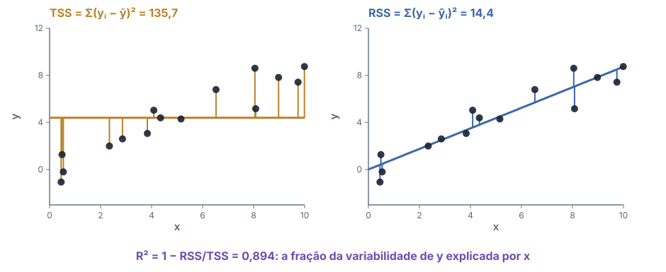{fig-alt="À esquerda, os desvios de cada ponto até a média de y (TSS); à direita, os resíduos até a reta de least squares (RSS), bem menores." width="64%" fig-align="center" .nostretch}

::: {.smaller-text}
- ***RSE*** $= \sqrt{\text{RSS}/(n-2)}$: o erro típico, nas unidades de $y$ (medida de *lack of fit*).
- ***$R^2$*** $= \dfrac{\text{TSS} - \text{RSS}}{\text{TSS}} = 1 - \dfrac{\text{RSS}}{\text{TSS}} \in [0, 1]$: a fração da variabilidade de $y$ explicada. Na regressão simples, $R^2 = \operatorname{Cor}(x, y)^2$.
:::

::: {.content-visible unless-format="revealjs"}
O TSS mede a variabilidade total de $y$ antes de olhar para $x$; o RSS, a que
sobra depois do ajuste. Para os dados de vendas versus TV:



Um $R^2$ "bom" depende da área: em física, valores próximos de 1 são esperados;
em ciências sociais ou biologia, valores bem menores podem ser realistas.
:::

## 2.2 *Multiple linear regression*

Com $p$ preditores, cada um ganha o seu peso:

$$
y = w_0 + w_1 x_1 + w_2 x_2 + \dots + w_p x_p + \varepsilon = w_0 + \mathbf x^\top \mathbf w + \varepsilon
$$

$w_j$: o efeito médio em $y$ de **aumentar $x_j$ em uma unidade, mantendo os outros preditores fixos**.

$$
\text{sales} = w_0 + w_1 \cdot \text{TV} + w_2 \cdot \text{radio} + w_3 \cdot \text{newspaper} + \varepsilon
$$

### 2.2.1 Estimando os coeficientes

:::: {.columns}

::: {.column width="56%"}
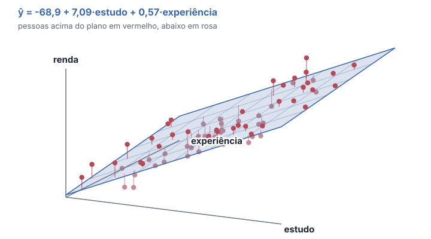{fig-alt="Plano de regressão de vendas sobre TV e radio, com os pontos acima e abaixo do plano e seus resíduos."}
:::

::: {.column width="44%" .smaller-text}
- Novamente, *least squares*: minimizar
  $$\text{RSS} = \sum_{i=1}^{n} \big(y_i - \hat w_0 - \hat w_1 x_{i1} - \dots - \hat w_p x_{ip}\big)^2$$
- Com dois preditores, o ajuste é um **plano**; com $p$, um hiperplano.
- Em forma matricial (Cap. 1): com $\tilde{\mathbf X} = [\mathbf 1 \;\; \mathbf X]$ e $\tilde{\mathbf w} = (w_0, \mathbf w)$,
  $$\hat{\tilde{\mathbf w}} = (\tilde{\mathbf X}^\top \tilde{\mathbf X})^{-1} \tilde{\mathbf X}^\top \mathbf y$$
  (as *normal equations*).
:::

::::

### Simples × múltipla: o caso do *newspaper* {.unlisted}

::: {.smaller-text}
Três regressões simples, uma para cada mídia:



Uma regressão múltipla com as três:


:::

- Sozinho, *newspaper* parece importante; junto com radio, **não**.



::: {.content-visible unless-format="revealjs"}
A regressão simples de vendas sobre newspaper capta, indiretamente, o efeito
de radio: onde se gasta mais em newspaper também se gasta mais em radio, e é
radio que aumenta as vendas. Na regressão múltipla, o coeficiente de
newspaper mede o efeito **mantendo radio fixo**, e esse efeito é praticamente
nulo. A matriz de correlação completa:


:::

### 2.2.2 Algumas perguntas importantes

1. Pelo menos um dos preditores $x_1, \dots, x_p$ é útil para prever a resposta?
2. Todos os preditores ajudam a explicar $y$, ou só um subconjunto?
3. Quão bem o modelo se ajusta aos dados?
4. Dados valores dos preditores, que resposta devemos prever, e com que precisão?

::: aside
ISLP, §3.2.2.
:::

### Pergunta 1: o *F-statistic* {.unlisted}

$H_0: w_1 = w_2 = \dots = w_p = 0 \quad$ versus $\quad H_a$: pelo menos um $w_j \neq 0$.

$$
F = \frac{(\text{TSS} - \text{RSS}) / p}{\text{RSS} / (n - p - 1)}
$$

- Se $H_0$ é verdadeira, $F \approx 1$; se $H_a$ é verdadeira, $F > 1$.
- Por que não olhar só os *p-values* individuais? Com $p = 100$ e $H_0$ verdadeira, cerca de 5 *p-values* ficariam abaixo de 0,05 **por acaso**. O *F-statistic* corrige isso.

::: {.smaller-text}

:::

### Pergunta 2: *variable selection* {.unlisted}

- Com $p$ preditores há $2^p$ modelos possíveis: com $p = 30$, mais de um bilhão. Não dá para testar todos.
- ***Forward selection***: começa sem preditores e adiciona, um a um, o que mais reduz o RSS.
- ***Backward selection***: começa com todos e remove, um a um, o de maior *p-value*.
- ***Mixed selection***: adiciona como no *forward*, mas remove variáveis que deixam de ser significativas.
- Para comparar os modelos: *Mallow's $C_p$*, *AIC*, *BIC*, *adjusted $R^2$* ou *cross-validation* (Cap. 1).

### Perguntas 3 e 4: ajuste e predição {.unlisted}

- ***$R^2$*** sempre aumenta quando adicionamos preditores, **mesmo inúteis**; olhe também o RSE e, de preferência, o erro em dados novos.
- Toda predição tem incerteza. Para TV = 100 e radio = 20:

::: {.smaller-text}

:::

- O ***prediction interval*** é sempre mais largo: além da incerteza em $\hat{\mathbf w}$, inclui o *irreducible error* $\varepsilon$.

## 2.3 Outras considerações no modelo de regressão

Preditores qualitativos, extensões além do modelo aditivo e linear, e o que pode dar errado num ajuste.

### 2.3.1 *Qualitative predictors*

:::: {.columns}

::: {.column width="50%"}
**Dois níveis**: uma *dummy variable*

$$
x_i = \begin{cases} 1 & \text{se a pessoa } i \text{ tem casa própria} \\ 0 & \text{caso contrário} \end{cases}
$$

$y_i = w_0 + w_1 x_i + \varepsilon_i$: $w_0$ é a média de quem **não** tem casa; $w_0 + w_1$, a de quem tem.
:::

::: {.column width="50%"}
**Mais níveis**: $K - 1$ *dummies* e um nível de referência (*baseline*):

| região | $x_{i1}$ (South) | $x_{i2}$ (West) |
|---|:---:|:---:|
| East (*baseline*) | 0 | 0 |
| South | 1 | 0 |
| West | 0 | 1 |

Em ML isso é o ***one-hot encoding***, removendo uma coluna para não repetir o *intercept*.
:::

::::

::: aside
ISLP, §3.3.1 (dados *Credit*).
:::

### 2.3.2 Extensões do modelo linear

:::: {.columns}

::: {.column width="58%"}
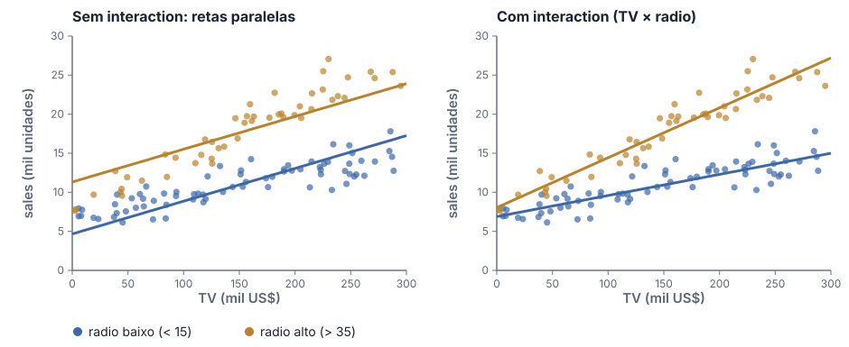{fig-alt="Vendas versus TV para mercados com pouco e muito radio: sem interaction as retas são paralelas; com interaction, a inclinação é maior quando há mais radio."}
:::

::: {.column width="42%" .smaller-text}
O modelo aditivo supõe que o efeito de TV **não depende** de radio. Um termo de ***interaction*** relaxa isso:

$$
\begin{aligned}
\text{sales} = {} & w_0 + w_1 \text{TV} + w_2 \text{radio} \\
& + w_3 (\text{TV} \times \text{radio}) + \varepsilon
\end{aligned}
$$

- O *slope* de TV vira $w_1 + w_3 \cdot \text{radio}$: **sinergia** entre as mídias.
- ***Hierarchical principle***: se incluímos a *interaction*, mantemos também os efeitos principais.
:::

::::

::: {.content-visible unless-format="revealjs"}
Com os dados simulados, o modelo com *interaction*:


:::

### Relações não lineares: *polynomial regression* {.unlisted}

:::: {.columns}

::: {.column width="58%"}
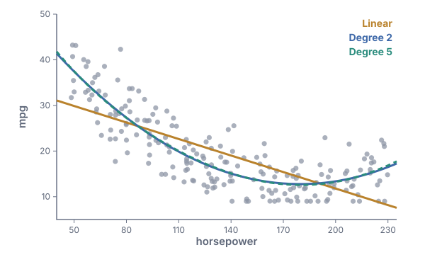{fig-alt="Consumo (mpg) versus potência (horsepower): ajustes linear, de grau 2 e de grau 5."}
:::

::: {.column width="42%"}
$$
\text{mpg} = w_0 + w_1 \cdot \text{hp} + w_2 \cdot \text{hp}^2 + \varepsilon
$$

- Ainda é um ***linear model***: é linear nos **pesos** $\mathbf w$; só criamos a *feature* $x_2 = \text{hp}^2$.
- O grau 2 corrige a curvatura; o grau 5 acrescenta pouco e começa a seguir o ruído (*overfitting*, Cap. 1).
:::

::::

::: aside
Dados simulados, inspirados no conjunto *Auto* do ISLP, §3.3.2.
:::

### 2.3.3 Problemas potenciais

1. ***Non-linearity*** da relação entre resposta e preditores.
2. ***Correlation of error terms***: erros correlacionados (comum em séries temporais).
3. ***Non-constant variance*** dos erros (*heteroscedasticity*).
4. ***Outliers***: $y_i$ muito longe do previsto.
5. ***High-leverage points***: $x_i$ incomum.
6. ***Collinearity***: preditores fortemente correlacionados entre si.

### *Residual plots* {.unlisted}

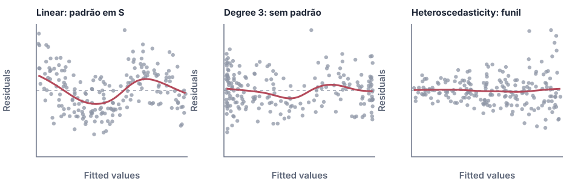{fig-alt="Três residual plots: um padrão em U para o ajuste linear, nenhum padrão para o de grau 2 e um funil de variância crescente." width="88%" fig-align="center" .nostretch}

- **Padrão** nos resíduos → *non-linearity*: use transformações como $\log x$, $\sqrt x$ ou $x^2$.
- **Funil** → *heteroscedasticity*: transforme a resposta, como $\log y$ ou $\sqrt y$.
- Resíduos em função do **tempo** com "ondas" → erros correlacionados.

### *Outliers* e *high-leverage points* {.unlisted}

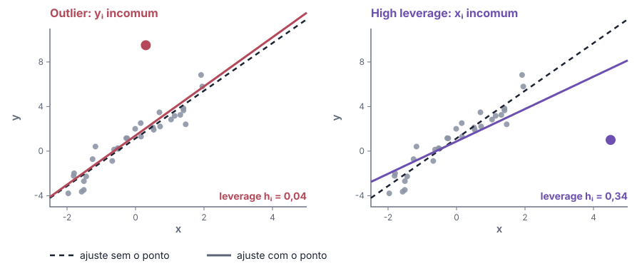{fig-alt="À esquerda, um outlier quase não muda a reta; à direita, um ponto de alto leverage puxa a reta para si." width="64%" fig-align="center" .nostretch}

::: {.smaller-text}
- Um *outlier* pouco muda a reta, mas infla o RSE e reduz o $R^2$. *Studentized residuals* $> 3$ são suspeitos.
- Um *high-leverage point* puxa a reta. ***Leverage statistic***: $\; h_i = \dfrac{1}{n} + \dfrac{(x_i - \bar x)^2}{\sum_{i'} (x_{i'} - \bar x)^2}$, com média $(p + 1)/n$.
:::

### *Collinearity* {.unlisted}

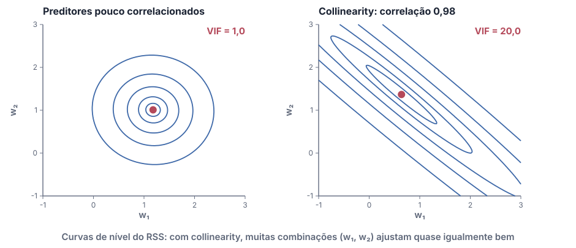{fig-alt="Curvas de nível do RSS: círculos para preditores pouco correlacionados; elipses longas e estreitas com collinearity." width="60%" fig-align="center" .nostretch}

::: {.smaller-text}
- Com *collinearity*, fica difícil separar o efeito de cada preditor: os *standard errors* crescem e os *t-statistics* caem.
- ***Variance inflation factor***: $\;\text{VIF}(\hat w_j) = \dfrac{1}{1 - R^2_{x_j \mid x_{-j}}}$ (o $R^2$ de $x_j$ regredido nos outros). VIF $> 5$ ou $10$ é preocupante.
- Soluções: remover uma das variáveis, ou combiná-las numa só.
:::

## 2.4 O plano de marketing

::: {.smallest-text .incremental-rows}


[ISLP, §3.4. Números calculados com os dados simulados deste capítulo.]{style="color:#5c6577"}
:::

## 2.5 *Linear regression* versus *K-nearest neighbors*

*Linear regression* é um método ***parametric***; ***KNN regression*** é ***non-parametric*** (Cap. 1):

$$
\hat f(\mathbf x_0) = \frac{1}{K} \sum_{i \in \mathcal N_0} y_i
$$

a média das respostas dos $K$ vizinhos de treino mais próximos de $\mathbf x_0$.

### *KNN regression* {.unlisted}

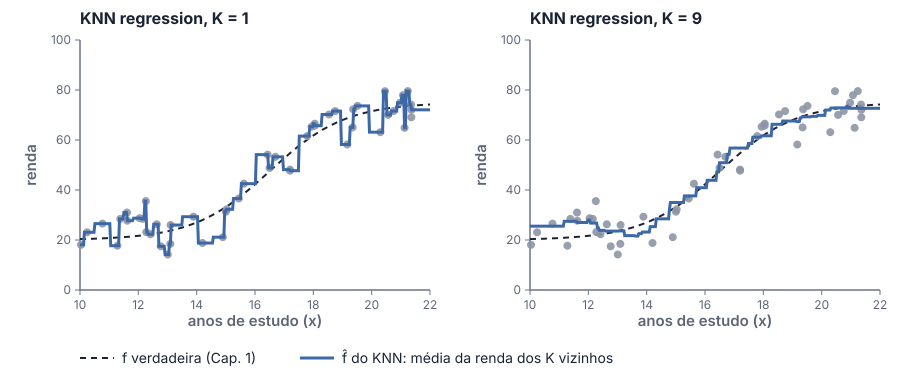{fig-alt="KNN regression com K igual a 1, que segue cada ponto, e com K igual a 9, mais suave." width="80%" fig-align="center" .nostretch}

- $K = 1$: interpola os dados (*low bias*, *high variance*). $K$ maior: mais suave (mais *bias*, menos *variance*).
- O melhor $K$ é escolhido por *cross-validation* (Cap. 1).

### Quando cada um vence? {.unlisted}

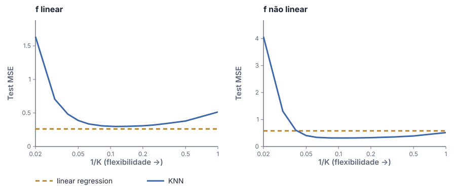{fig-alt="Test MSE do KNN em função de 1/K, comparado com o da linear regression: com f linear, a regressão vence; com f não linear, o KNN vence." width="80%" fig-align="center" .nostretch}

- Se a forma suposta está **próxima** da $f$ verdadeira, o método *parametric* vence.
- Se $f$ é bem **não linear**, o KNN pode vencer, com $K$ bem escolhido.

### *Curse of dimensionality* {.unlisted}

:::: {.columns}

::: {.column width="55%"}
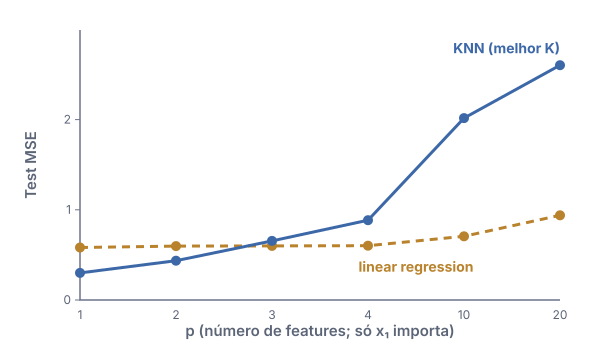{fig-alt="Test MSE versus número de features: a linear regression piora devagar; o KNN piora rapidamente."}
:::

::: {.column width="45%"}
- Aqui só $x_1$ importa; as outras *features* são ruído.
- Com $p$ grande, os "vizinhos mais próximos" ficam **longe**: o KNN perde a vantagem.
- Regra geral: *parametric methods* tendem a vencer quando há **poucas observações por preditor**.
:::

::::

::: aside
ISLP, §3.5.
:::

## Recursos online

- [**Deep Learning**](https://www.deeplearningbook.org/), Goodfellow, Bengio & Courville (MIT Press, 2016). Livro completo, gratuito online.
- [**An Introduction to Statistical Learning**](https://www.statlearning.com/) (ISLR / ISLP), James, Witten, Hastie, Tibshirani & Taylor. PDFs gratuitos, com versões em R e em Python. Este capítulo segue o cap. 3.
- [**The Hundred-Page Machine Learning Book**](https://themlbook.com/), Andriy Burkov. Uma visão geral concisa de *machine learning*.
- [**Programa de Mestrado: Machine Learning (2026)**](https://www.youtube.com/playlist?list=PLo4jXE-LdDTRLGDL59SkkLPBHVmYphuqI), IMPA. Playlist de aulas no YouTube, em português.
